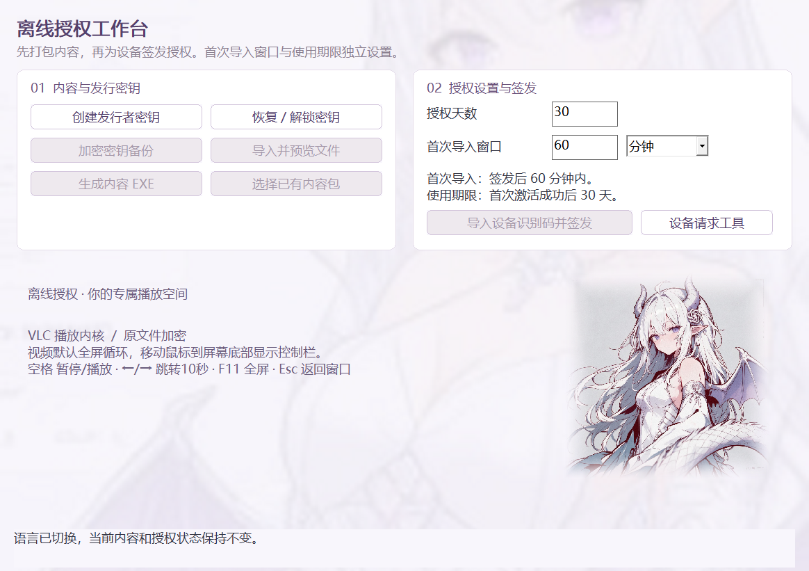

# Encrypt your digital assets

[English](README.md) · Rust · Windows 与 Ubuntu

为视频、音频、演示文稿、图片和文档提供离线加密、设备绑定与 LIC 授权。请按接收方的操作系统选择版本：

| 版本 | 下载 | 源码与使用说明 |
| --- | --- | --- |
| Windows x64 · 2.5.0 | [Windows 便携包](https://github.com/shuizhaodemumu/Encrypt-your-digital-assets/releases/tag/v2.5.0) | 仓库根目录；下文为 Windows 说明 |
| Ubuntu x86_64 · 0.1.2 | [DEB 安装包 / 自带运行库 RUN](https://github.com/shuizhaodemumu/Encrypt-your-digital-assets/releases/tag/ubuntu-v0.1.2) | [Ubuntu 使用与构建](ubuntu/README.zh-CN.md) · [验证范围](ubuntu/VALIDATION.md) |

Ubuntu 自带 VLC、GTK、Poppler 和 LibreOffice，**不创建开机或登录自启动项**；已实测 Ubuntu 26.04.1 x86_64。Windows 的 PPT 由 PowerPoint COM 放映，Ubuntu 使用内置 Impress。内容需要针对目标平台重新打包并签发授权。

## 两个平台统一视觉

Windows 2.5.0 采用 Ubuntu 工作台的淡紫色全窗口背景、半透明圆角卡片、宽松排版和页眉语言切换按钮；所选内容/内容包有独立提示，打开预览后使用紧凑工具区。

两个版本统一使用**抱着紫色锁的白发小龙娘**图标。Windows 把多尺寸 ICO 写入 EXE、窗口与安装入口，新打包的内容 EXE 也会继承；Ubuntu 的 DEB/RUN 同时包含菜单图标、窗口图标和八种尺寸。更新管理员程序不会自动修改已分发的旧内容程序。


## Windows 2.5.0

把视频、PPT、图片和文档打包成加密 Windows EXE，再为接收者签发离线、设备绑定的授权。接收者导出加密设备报告，管理员返回 `.lic` 文件，导入验证后才能打开内容，不需要在线激活服务器。



## 能做什么

| 内容或功能 | 当前行为 |
| --- | --- |
| 视频 | MP4、MKV、AVI、MOV、WEBM 使用内置 LibVLC；授权后默认全屏、隐藏控件、单文件循环。到结尾由播放器重复，不关闭再重开EXE。MOV采用随附avformat解复用器。 |
| 音频 | MP3、WAV、M4A、FLAC、OGG由LibVLC播放，提供播放与音量控制；不把视频循环策略泛化成所有音频都循环。 |
| PowerPoint | 加密原始PPT/PPTX/PPS/PPSX，通过桌面版PowerPoint COM接口放映，保留动画、切换等原文稿功能，不转静态PDF。实际兼容性取决于PowerPoint版本和文稿本身。 |
| PDF、文本、图片 | PDFium通过内存回调渲染PDF；TXT和PNG/JPEG/GIF/BMP/TIFF等图片由内置查看器显示，不承诺所有动图播放效果。 |
| Word | 管理员端调用单独安装的LibreOffice，把DOC/DOCX转成PDF后加密；接收者看到转换后的页面，不是可编辑Word文件。 |
| 离线授权 | 加密硬件报告、稳定设备指纹、签名LIC、自定义首次导入窗口、从首次激活起计算使用天数、密钥口令加密备份。 |
| 登录自启动 | 授权后校验并保存安装副本，写入当前用户Windows Run启动项；在用户登录后启动，不是无人登录时运行的系统服务。提供修复及取消入口。 |
| 故障恢复 | 后台心跳监测播放故障或失去响应并重启程序；正式版沿用“10分钟内第三次故障重启后，直接重启电脑”的策略。暂停、正常退出、授权到期和正常视频循环不算故障。 |
| 图形界面 | 中英双语、前置条件禁用、输入实时校验、签发确认、有效设置记忆；2.5.0保留全窗口淡背景，右侧插画取消白框并柔和羽化。 |

文件扩展名支持不代表所有编码、分辨率和显卡驱动都兼容。PowerPoint和LibreOffice均需自行安装，不随程序分发。

## 使用流程

从[Releases](https://github.com/shuizhaodemumu/Encrypt-your-digital-assets/releases)下载当前便携包，解压到可写目录后运行`Packager.exe`。源码构建脚本会在`程序/`生成管理员`Packager.exe`、设备工具`DeviceTool.exe`和安装器`Packager-Setup.exe`。为兼容现有脚本和包，二进制及内部Cargo名称保持稳定；项目展示名为 **Encrypt your digital assets**。

1. 管理员创建或解锁发行者密钥。`.issuerkey`、口令和管理员内容目录`.olmeta`不要交给接收者。
2. 导入原文件预览，生成加密内容EXE，将EXE发送给接收者。
3. 接收者首次打开EXE，点击“获取本机设备识别码”，导出加密JSON设备报告并交给管理员（工作流兼容旧`.josn`命名）。
4. 管理员选择对应内容包，设置授权天数与首次导入窗口，导入该设备报告。
5. 核对确认摘要后签发LIC，发给接收者，在窗口期内导入。
6. 验证成功后打开内容，从首次激活成功时开始计算使用期限，同时启用登录自启动和运行监测。

### 两个时间设置，分别计算

- **首次导入窗口**：正整数，可选秒、分钟、小时或天，初始默认**60秒**。点击确认签发时开始计时。例如设置2小时，就有2小时用来传递并首次导入LIC。
- **授权天数**：正整数，从接收者首次激活成功时计算，不是从管理员签发时计算。

空白、零、负数、小数、溢出和超出日期范围会被拒绝；记忆最后有效设置。取消签发确认不会生成LIC；新授权替换原期限，不叠加天数。窗口截止时间属于签名正文，直接编辑LIC无法延长。

旧EXE内嵌旧验证器，不会因管理员软件升级自动变化。要使用自定义窗口，需要用本版重新打包原文件，再导出报告和签发；选择旧包时会阻止非60秒签发。新接收端兼容历史60秒授权。

### 视频操作与自启动

鼠标移到屏幕底部显示控制栏，稍后自动隐藏。空格暂停/播放，左右方向键跳转10秒，F11切换全屏，Esc从全屏返回窗口；窗口模式Esc退出。同一视频正常循环保持同一进程。

取消某个内容的登录启动：

```powershell
.\程序\Packager.exe --disable-startup "C:\路径\内容.exe"
```

不要为取消单个内容而删除整个共享用户数据目录：设备密钥可能被多个内容共用。启动项在当前用户登录后执行；Windows延迟或用户禁用启动应用会影响实际自动运行。

## 如何实现

```text
原文件 → 分块加密 → 播放器EXE + 追加密文
接收端硬件信息 + 设备公钥 → 加密设备报告
管理员发行者密钥 + 内容目录 → 签名且为设备封装内容密钥的LIC
接收端校验签名、内容、设备、时间 → 解密显示或播放
```

- **内容加密**：随机内容密钥，1 MiB的AES-256-GCM分块与认证元数据；密文追加到播放器EXE。随机读取按需解密，供视频寻址和PDF回调使用。
- **LIC验证**：ECDSA P-256签名正文，RSA-OAEP/SHA-256为设备封装内容密钥；核对内容ID、发行者、硬件策略和时间约束。
- **设备报告**：临时P-256 ECDH协商，HKDF-SHA-256派生密钥，AES-256-GCM加密完整采集信息，仅对应发行者可解密。
- **密钥与本机状态**：发行者私钥采用PKCS#8口令加密，PBKDF2-HMAC-SHA-256迭代600,000次和AES-256-CBC；设备私钥和激活状态由Windows DPAPI保护。
- **硬件采集**：PowerShell/CIM查询电脑、主板、产品UUID、磁盘、CPU、BIOS、内存和物理网卡信息。稳定指纹排除USB移动磁盘和变化的连接状态，完整硬件信息仍加密保存在报告里；不采集IP、DNS、公网IP归属地。更换参与绑定的硬件可能需要重新签发，不承诺任意换件都能保持授权。
- **显示与重绘**：Rust调用原生Win32控件；离屏绘制和模态期间缓存帧避免重入黑屏。右侧插画通过预乘透明度和AlphaBlend融入背景，内容预览占用工作区时隐藏插画。
- **运行库**：LibVLC DLL/插件和PDFium随`assets/runtime.zip`嵌入并在本地释放；PowerPoint使用独立宿主/COM路径；Word转换仅在管理员端调用LibreOffice。

### 保护边界

这是离线授权和加密分发工具，不保证内容绝对无法复制。合法观看会输出画面和声音，控制操作系统的接收者仍可能录屏、抓取内存或修改程序。原生PowerPoint放映需要临时解密文件，“只放映”不能消除提取风险。纯离线客户端无法获得可信服务器时间或远程撤销信息。请保管发行者密钥和内容目录，加密设备报告也属于敏感管理资料。

## 构建

图标资源由 `build.rs` 编译：MSVC 使用 Windows SDK 的 `rc.exe`，GNU 使用 `windres`；可通过 `RC` / `WINDRES` 指定资源编译器。

需要Windows x64、较新的稳定版Rust及匹配的链接器，使用Rust 2021。常规MSVC环境需Visual Studio C++ Build Tools/Windows SDK；GNU环境需MinGW或LLVM链接器。Rust依赖由`Cargo.lock`固定。

```powershell
git clone https://github.com/shuizhaodemumu/Encrypt-your-digital-assets.git
cd Encrypt-your-digital-assets
cargo fmt --check
cargo test --locked
cargo build --locked --release
# 或构建并生成三个角色入口：
.\build\build.ps1 -Release
```

PowerShell脚本支持`OFFLINE_RUST_SDK`指定现有GNU SDK目录，也会回退到PATH中的`cargo.exe`，普通构建不要求作者的D盘目录结构。直接Cargo构建结果为`target/release/offline-license-rust.exe`，脚本把它复制成三个入口名称。

### 测试与验证范围

图形测试需要交互式Windows桌面、**测试构建**和相应短视频夹具，细节见[VALIDATION.md](VALIDATION.md)。

```powershell
cargo build --locked --features watchdog-test-mode
.\build\ui-test.ps1 -SkipBuild
.\build\paint-ui-test.ps1 -Version 2.5.0
# 可选：准备work/sample.mp4后运行媒体端到端回归
.\build\video-e2e.ps1 -Formats mp4
```

`watchdog-test-mode`仅供自动测试禁用真实电脑重启，正式构建不要启用。不要把真实重启/注销用于自动验收；合成发行者、设备报告和LIC测试产物不得提交到仓库。

常规单元测试23项通过，另1项需桌面的原生用例在默认运行中忽略。实际GUI已检查双语弹窗、预览、自定义窗口签发与导入、模态重绘、无白框像素及60次窗口大小/语言切换。MP4循环、自启动注册与恢复及此前五格式测试各有范围，不等同所有编码、混合DPI、多台电脑、真实重启登录和所有Office版本都通过。

## 源码结构

| 路径 | 负责内容 |
| --- | --- |
| `src/core.rs` | 包格式、分块加密、密钥存储与签名授权 |
| `src/hardware.rs`、`assets/hardware.ps1` | 硬件策略与加密设备报告 |
| `src/issuance.rs`、`src/session.rs` | 窗口配置、激活、运行时授权 |
| `src/native.rs` | LibVLC/PDFium FFI及加密读取/寻址回调 |
| `src/presentation.rs`、`src/automation.rs` | PowerPoint宿主、COM与放映生命周期 |
| `src/platform.rs`、`src/install.rs`、`src/watchdog.rs` | DPAPI、安装自启动与心跳恢复 |
| `src/gui.rs`、`src/i18n.rs` | Win32界面、双语状态与分层绘制 |
| `build/` | 构建、GUI和媒体回归脚本 |

## 第三方与美术素材

LibVLC、PDFium和Rust依赖声明见[第三方说明](第三方说明.md)及`third-party-licenses/`。本Rust程序动态调用原生库，不依赖.NET/LibVLCSharp。第三方组件许可不等于仓库所有图片的统一授权。

铺满窗口的背景仍来自用户提供的素材库，[背景来源](docs/artwork-provenance.json)保留原出处。抱锁龙娘原图由本地 MiniMax H3 生成并经用户选定，再用内置图像工具适配透明方形图标，最后转换为 ICO/PNG 多尺寸；Windows 页脚也采用同一形象。见[图标来源记录](docs/app-icon-provenance.json)。

私钥、LIC、硬件报告、本机SDK、测试工作目录、旧版备份和成品包不提交源码仓库；可执行下载放在Releases中。
