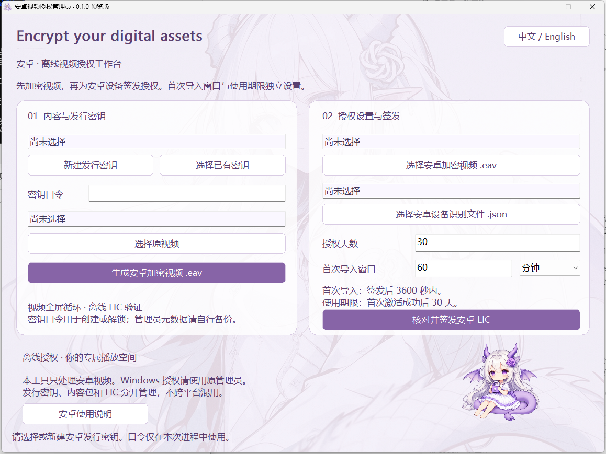

# Encrypt your digital assets — 安卓视频预览版

独立目录内开发，保留现有 Windows 和 Ubuntu 版本。当前为 0.1.0-preview，面向 ARM64 / Android 8+；实际兼容范围以真机记录为准。

Rust 实现 1 MiB AES-256-GCM 视频分块、P-256 签名、加密设备请求、设备密钥封装和随机读取。原生 Android Java 界面使用 LibVLC 3.7.7 播放，Android Keystore 存储设备私钥和本地状态密钥。借助 ProxyFileDescriptorCallback 将按需解密数据提供给 VLC，不生成完整明文视频临时文件。

电脑管理员工具生成 `.eav`，安卓端导入后导出加密 JSON，管理员签发 `.lic`，安卓导入成功后全屏循环。授权天数从首次成功激活开始，相同 LIC 重复导入不重新计时。授权播放中持续检查到期和明显时间回退。

首版使用“播放器 APK + 加密视频包”，不含 Office/PPT，不设置开机自启动，不执行 Root 命令和真实设备重启。Root 故障守护、逐内容独立 APK、原 Windows 管理员内部整合不在此次预览版内。安卓协议版本独立，旧 Windows/Ubuntu 包和 LIC 不能直接导入。

## 构建

`build/core.ps1 -Mode test|android|host|fmt` 使用本机已安装的 Rust、NDK 和 GNU 工具链，使用临时盘符兼容中文项目路径。`build/apk.py [--debug]` 使用已有 JDK、aapt2 和 D8 打包、签名 APK。路径固定于当前开发机，换开发机需调整。终端用户不需要这些构建环境。

APK 的测试动作只在 debuggable 构建中生效，不绕过签名、设备密钥或 LIC 验证。生产构建关闭调试，并启用 FLAG_SECURE。屏幕保护不保证能抵抗 Root 注入或外部拍摄。

已生成的非调试预览 APK 和独立的 Windows 安卓授权管理员 EXE 在 `outputs/`。面向使用者的操作步骤见 [使用说明](使用说明.md)，真机验证记录见 `VALIDATION.md`。播放时保持屏幕常亮，返回首页后恢复系统正常息屏行为。已声明禁止普通应用捕获播放音频，系统及 Root 环境下的音频捕获边界尚未专项验证。

## 独立的安卓管理员

双击 `video-admin.exe` 打开 Rust 原生图形界面。背景、双栏圆角卡片、主按钮和抱锁小龙娘复用 Windows / Ubuntu 的视觉；主要界面可中英切换，校验提示和系统对话框部分仍为中文或系统语言。左侧管理密钥与视频，右侧选择安卓设备请求、设置授权天数和首次导入窗口并确认签发。

它只签发安卓内容，不修改原 Windows 管理员，不共用其配置或发行密钥。图形界面口令仅保存在进程内；文件加密和签发在后台执行，失败显示原因。

## 管理员 CLI（仍兼容）

设置 `EAV_ISSUER_PASSWORD`（至少 8 字符），然后运行 `video-admin init issuer.issuerkey`、`video-admin pack issuer.issuerkey video.mp4 output.eav`、`video-admin issue issuer.issuerkey output.eav device.json output.lic 30 3600`。最后两项为授权天数、首次导入窗口秒数。

发行私钥以 PBKDF2-SHA256（300000 次）和 AES-GCM 口令加密保存。视频旁的 `.eav.adminmeta` 包含加密的管理员元数据，不能丢失。只向用户分发 APK、`.eav` 和对应 `.lic`，不要发送发行密钥、口令、签名密钥或 `.adminmeta`。`work/` 下为开发私有材料，禁止公开上传。

## 测试边界

Rust 往返测试包含跨块读取、随机读取、错设备、伪造签名、到期、被篡改视频和发行口令错误。手机测试使用独立合成视频，实际结果写入 VALIDATION.md。完全离线与 Root 环境不能提供绝对防破解、防时间回滚保证。

LibVLC 及第三方依赖沿用各自许可证。本项目自有新增代码为 MIT；现有龙娘图像复用，不在本次重新生成。
