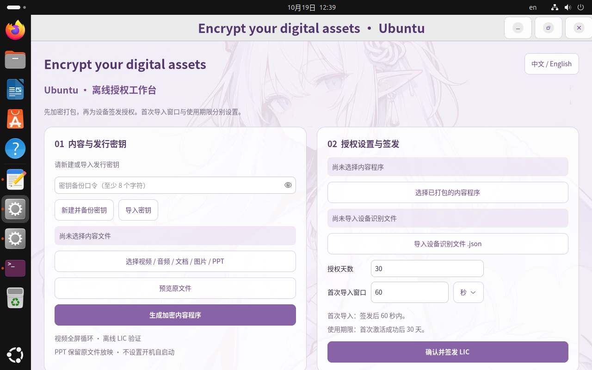

# Encrypt your digital assets · Ubuntu

[中文说明](README.zh-CN.md) · **Ubuntu 0.1.2** · Linux x86_64 · Rust / GTK4

Encrypt video, audio, presentations, images and documents into a distributable Linux application. The recipient exports an encrypted device request; the administrator issues a signed, device-bound `.lic` file for offline activation. **This edition creates no boot or login autostart entry.**



Version 0.1.2 fixes the video control bar: after 3 seconds without pointer movement it slides down into a slim bottom dock, and pointer motion slides it back up. Video continues looping in the same player window. No boot/login autostart is added.

## Install

Download from [Ubuntu 0.1.2 Releases](https://github.com/shuizhaodemumu/Encrypt-your-digital-assets/releases/tag/ubuntu-v0.1.2). Choose either:

| Download | Use |
| --- | --- |
| `encrypt-assets-ubuntu_0.1.2_amd64.deb` | Install with the Ubuntu software installer, then open **Encrypt your digital assets** from the application menu. |
| `Encrypt-assets-Ubuntu-0.1.2-release-x86_64.run` | Run `sh ./Encrypt-assets-Ubuntu-0.1.2-release-x86_64.run`; no sudo is required. |

The packages bundle GTK, VLC and its plugins, Poppler, LibreOffice Writer/Impress, Python/UNO, Noto CJK fonts and their native libraries. Users do not need Rust, Cargo, Docker or a separate Office/player installation. First launch verifies and extracts a shared per-user runtime. Allow at least 2 GiB of free space, plus space for source files and encrypted content. Downloads are about 370 MiB each; the extracted runtime is about 910 MiB.

Tested on **Ubuntu 26.04.1 x86_64**. The private dynamic loader reduces host-library dependencies; it does not establish compatibility with every Linux distribution, kernel, GPU or sound device. Windows and ARM cannot run these packages. See the [installation guide (Chinese)](docs/安装与使用.md) and [validation scope](VALIDATION.md).

## Package and license

1. Create or load a password-protected issuer key. Keep the `.issuerkey`, its password and administrator-only `.olmeta` records private.
2. Choose the original file and generate its encrypted content program. The installed/bundled application creates a single `.run` containing the runtime and encrypted payload. An unbundled developer binary creates a system-dependent `.bin`.
3. Send only the content `.run` to the recipient. It works without first installing the administrator application. Each content download includes the runtime; the same runtime is shared after extraction for that user.
4. The recipient opens it, exports an encrypted device `.json` and returns it to the administrator.
5. Select the matching content package and device request, set the usage days and first-import window, review the confirmation and issue a `.lic`.
6. The recipient imports the LIC before its deadline. Valid content opens, and later manual launches restore the unexpired activation.

The first-import window starts at issuance and accepts seconds, minutes, hours or days. Usage days start at the **first successful activation**. Reimporting the same LIC does not reset the term. Canceling the issuance confirmation creates no license.

## Supported content

| Content | Behavior |
| --- | --- |
| MP4 / MKV / AVI / MOV / WEBM | LibVLC reads authenticated, decrypted chunks through callbacks. Full-screen video hides controls and loops in the same process/window. |
| MP3 / WAV / M4A / FLAC / OGG | LibVLC audio with pause, seek and volume controls. The video looping policy is not a promise that all audio loops. |
| PDF / TXT | In-memory Poppler pages; read-only UTF-8 text with GBK fallback. |
| PNG / JPEG / GIF / BMP / TIFF | GTK image display; full animated-image support is not claimed. |
| DOC / DOCX / ODT | Bundled Writer converts to PDF during packaging, then the result is encrypted. |
| PPT / PPTX / PPS / PPSX / ODP | Encrypts the original file. Bundled Impress opens a hidden, read-only document via UNO and starts its slideshow; slides are not flattened into PDF. |

Video: Space pauses/resumes, Left/Right seek ten seconds, F11 toggles full-screen and Esc leaves it. Pointer movement reveals the controls. Codec support depends on the file and bundled plugins. LibreOffice presentation layout, fonts, animation and embedded media may differ from PowerPoint. Macros and external-link updates are disabled. Original presentations require a plaintext file in a private temporary directory during playback; normal close cleans it up, while power-loss cleanup has not been verified.

## Implementation and boundaries

- **Content:** random content keys and 1 MiB AES-256-GCM chunks, with authenticated metadata and chunk indexes.
- **Licenses:** ECDSA P-256 signatures; RSA-3072 OAEP/SHA-256 wraps the content key for the device. Content identity, device, signature and time are checked before use.
- **Enrollment:** ephemeral P-256 ECDH, HKDF-SHA-256 and AES-GCM protect the hardware report for the issuer.
- **Hardware:** readable `/sys` and `/proc` identity fields; stable binding excludes USB/removable disks and connection status. No public/local IP, DNS or location is collected. Inaccessible serials remain empty; unavailable DMI UUID falls back to `/etc/machine-id`. Reinstallation or VM hardware changes can require a new license.
- **Local state:** private 0700 directories, 0600 files and encryption with a local random master key. This is not Windows DPAPI or TPM-backed storage; the master key is in the user's private directory.
- **Recovery:** the supervisor watches playback/window health. Normal pause, close, expiry and video EOF are not faults. Faults restart the content program; the third fault restart within ten minutes requests an immediate system reboot, subject to Linux session permissions. Tests suppress actual reboot.

There is no XDG autostart, login service or system startup task. A menu shortcut is a manual launch entry. Offline protection cannot fully prevent screen recording, current-user/root memory access, patched binaries or whole-system state rollback; it has no remote revocation or trusted server clock. Repackage and relicense content for Linux: Windows EXEs and device-bound licenses are not automatically portable across platforms.

## Build from source

Build inside this `ubuntu/` directory on an Ubuntu x86_64 development machine. End users do **not** need these development dependencies:

```sh
sudo apt-get install build-essential pkg-config rustc cargo rustfmt \
  libgtk-4-dev libvlc-dev vlc-plugin-base vlc-plugin-video-output \
  libpoppler-glib-dev libreoffice-impress libreoffice-writer python3-uno \
  fonts-noto-cjk ffmpeg xvfb xdotool python3-pyatspi patchelf \
  desktop-file-utils bubblewrap dbus-x11
cargo fmt --check
ENCRYPT_ASSETS_DATA_DIR="$PWD/work/unit-state" cargo test --locked --features watchdog-test-mode -- --test-threads=1
cargo build --locked --release --features watchdog-test-mode
xvfb-run -a dbus-run-session -- target/release/encrypt-assets-ubuntu --self-check
xvfb-run -a dbus-run-session -- python3 tests/integration.py target/release/encrypt-assets-ubuntu
python3 build/bundle.py target/release/encrypt-assets-ubuntu --suffix test
xvfb-run -a dbus-run-session -- python3 tests/portable.py outputs/Encrypt-assets-Ubuntu-0.1.2-test-x86_64.run
# Production build: omit the test feature after finishing tests.
cargo build --locked --release
python3 build/bundle.py target/release/encrypt-assets-ubuntu --suffix release
```

`sh build/build-ubuntu.sh` runs the Rust checks and builds production installers. Use `watchdog-test-mode` for media/fault automation and never use a real machine restart as an automated acceptance check. Installer contents are built from the development machine's native components; byte-for-byte reproducibility across distributions is not claimed.

| Source | Responsibility |
| --- | --- |
| `src/core.rs`, `src/hardware.rs` | Container encryption, signatures, key wrapping and encrypted requests |
| `src/linux_hardware.rs`, `src/platform.rs` | Linux identity, private state and single-instance locking |
| `src/issuance.rs`, `src/session.rs` | First-import window and activation-based term |
| `src/media.rs`, `src/documents.rs`, `assets/impress_host.py` | VLC callbacks, Poppler and read-only Impress lifecycle |
| `src/gui.rs`, `assets/style.css` | Bilingual GTK interface, input validation and illustration |
| `src/watchdog.rs` | Heartbeats and bounded fault recovery |
| `build/bundle.py`, `tests/` | Self-contained installers and synthetic regressions |

Third-party notices and package versions are included in the extracted runtime under `docs/third-party` and `docs/runtime-manifest.json`. Relocation preserves the upstream UNO source and copyright notices. Artwork is the existing supplied reference, with [provenance](docs/artwork-provenance.json); no new H3-generated illustration is claimed. Component licenses do not grant blanket rights to the illustration.
